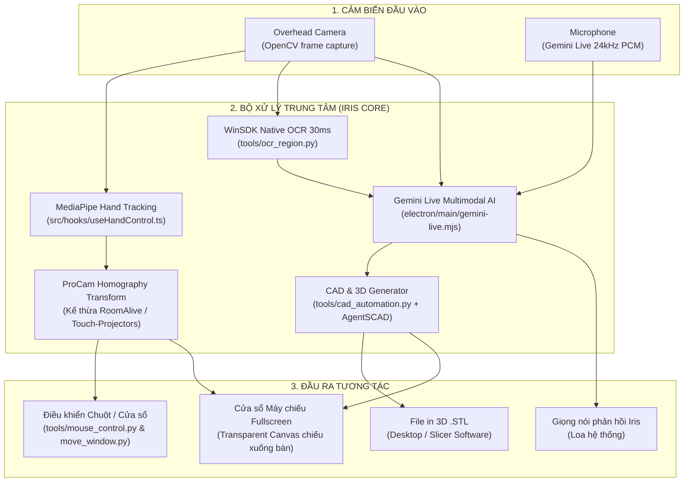

# KẾ HOẠCH PHÁT TRIỂN: HỆ THỐNG BÀN LÀM VIỆC KHÔNG GIAN (SPATIAL AI DESK) CHO IRIS

> **Mô hình phần cứng:** 1 Máy chiếu (Projector) chiếu thẳng góc xuống mặt bàn + 1 Camera (Overhead Camera) nhìn xuống bàn làm việc.  
> **Phím tắt kích hoạt:** `Alt + Space` (Kích hoạt Iris Desk Mode / Spatial Interface).

---

## 1. CÁC TÍNH NĂNG TRỌNG TÂM TRÊN BÀN LÀM VIỆC (PHẦN I)

### 1.1. Kéo cửa sổ máy tính "rơi" tuột xuống bàn (Infinite Desk Extension)
- **Trải nghiệm:** Khi màn hình chính chật chội, người dùng dùng tay nắm thanh tiêu đề cửa sổ trên màn hình máy tính và kéo tuột xuống dưới mép màn hình. Cửa sổ đó lập tức "trượt" khỏi màn hình máy tính và rơi thẳng xuống mặt bàn gỗ, biến mặt bàn thành màn hình phụ thứ hai.
- **Công nghệ:** Cửa sổ Electron thứ hai xuất ra màn hình phụ máy chiếu (`transparent: true, fullscreen: true`) + tính toán toạ độ chuyển giao liên tục giữa con trỏ chuột màn hình chính và mặt phẳng bàn.

### 1.2. Cửa sổ cảm ứng trên bàn: Chạm kéo & Pinch-to-Zoom (Ngón cái + Ngón trỏ)
- **Chạm di chuyển:** Chạm ngón trỏ vào thanh tiêu đề cửa sổ ảo đang chiếu trên bàn gỗ rồi kéo rê $\rightarrow$ cửa sổ trượt mượt mà theo đầu ngón tay đến bất kỳ góc nào trên bàn.
- **Pinch-to-Zoom:** Đặt ngón cái và ngón trỏ lên cửa sổ rồi tách rộng ra $\rightarrow$ phóng to cửa sổ; chụm 2 ngón lại $\rightarrow$ thu nhỏ cửa sổ.
- **Công nghệ:** Theo dõi khoảng cách giữa toạ độ `THUMB_TIP` (ngón cái) và `INDEX_FINGER_TIP` (ngón trỏ) qua MediaPipe để tính tỉ lệ `scale` và toạ độ `(x, y)`.

### 1.3. Quét X-Ray & Giải mã linh kiện phần cứng (AR Hardware Inspector)
- **Trải nghiệm:** Đặt bo mạch Arduino, chip, củ sạc, linh kiện điện tử lên bàn và hỏi *"Iris, đây là cái gì?"*. Máy chiếu chiếu một tia laser xanh quét dọc vật thể, sau đó tự động vẽ các đường line kỹ thuật nối ra mặt bàn kèm nhãn chú thích phát sáng (*"Chip ESP32 Wi-Fi"*, *"Cổng Type-C 65W"*, *"Chân nguồn 5V"*).
- **Công nghệ:** Camera overhead chụp ảnh gửi thẳng vào Gemini Live Multimodal Vision $\rightarrow$ AI trả về nhãn và toạ độ linh kiện $\rightarrow$ Máy chiếu vẽ khung đồ hoạ neon đè đúng vị trí vật thể.

### 1.4. Vòng hào quang tìm đồ vật thất lạc (Aura Object Locator)
- **Trải nghiệm:** Khi bàn làm việc bừa bộn nhiều sách vở, đồ dùng, người dùng hỏi *"Iris, chìa khóa / bút của tôi ở đâu?"*. Camera lập tức quét mặt bàn và máy chiếu vẽ một **vòng tròn hào quang Neon phát sáng nhấp nháy (Pulsing Aura)** bao quanh đúng đồ vật kèm nhãn tên nhỏ ở dưới (`[Chìa khóa nhà]`, `[Bút dạ]`). Nhấc đồ vật lên thì hào quang tan biến.
- **Công nghệ:** Object Detection & Grounding qua mô hình thị giác $\rightarrow$ chuyển đổi bounding box sang toạ độ máy chiếu để render hiệu ứng hạt phát sáng.

### 1.5. Thước đo Laze quang học chuẩn Milimet (Virtual Laser Caliper)
- **Trải nghiệm:** Đặt 2 đầu ngón tay vào 2 mép vật thể hoặc để Iris tự bắt mép vật thể trên bàn $\rightarrow$ Máy chiếu chiếu một đường thước laze màu xanh nối giữa 2 điểm với vạch milimet và hiển thị số đo thực tế theo thời gian thực (sai số chỉ $\pm 0.5 - 1\text{ mm}$).
- **Công nghệ:** Tỉ lệ Pixels-per-Metric (PPM) được khoá chuẩn qua camera bằng cách hiệu chuẩn 1 lần với thẻ kích thước quốc tế (thẻ ATM / đồng xu).

### 1.6. AI Thiết kế & Sinh file in 3D (.STL Generator)
- **Trải nghiệm:**
  1. Đặt vật mẫu lên bàn (ví dụ: pin, bo mạch, chìa khoá), thước đo tự bắt kích thước chính xác (`52mm x 28mm`).
  2. Người dùng ra lệnh giọng nói: *"Iris, thiết kế một hộp đựng vừa khít vật này, dày 2mm, có nắp trượt để in 3D"*.
  3. AI tự động sinh mã CAD tham số và xuất thẳng file **`.STL` / `.STEP`** ra Desktop.
  4. Máy chiếu chiếu **mô hình 3D xoay 360 độ** ngay trên mặt bàn để người dùng kiểm tra trước khi bấm in.
  5. Tự động mở phần mềm cắt lớp (Bambu Studio / Cura / PrusaSlicer) nạp sẵn file in.

---

## 2. CÁC GITHUB REPO THAM KHẢO & ÁNH XẠ CÔNG NGHỆ

Dưới đây là 4 repository mã nguồn mở tiêu biểu tương ứng với từng mảnh ghép công nghệ để tích hợp vào Iris:

| GitHub Repository | Vai trò & Công nghệ cốt lõi ứng dụng vào Iris |
| :--- | :--- |
| **[microsoft/RoomAliveToolkit](https://github.com/microsoft/RoomAliveToolkit.git)** | **Cân chỉnh Máy chiếu - Camera (ProCam Calibration):** - Bộ công cụ của Microsoft Research giúp tự động cân chỉnh ma trận toạ độ giữa camera và máy chiếu (Perspective Transformation / Homography). - Đảm bảo vị trí máy chiếu chiếu ra khớp chính xác từng milimet với điểm ngón tay chạm trên mặt bàn gỗ. |
| **[technospes/AURA_Project](https://github.com/technospes/AURA_Project.git)** | **Trợ lý Không gian Cử chỉ + Giọng nói (HCI Minority Report):** - Kết hợp MediaPipe Hand Tracking với nhận diện giọng nói và mô hình ngôn ngữ lớn (LLM). - Cung cấp mô hình tương tác cử chỉ không chạm để kích hoạt các lệnh thông minh của trợ lý. |
| **[Subhajitdas99/AI-Gesture-Controlled-App](https://github.com/Subhajitdas99/AI-Gesture-Controlled-App)** | **Ánh xạ Cử chỉ sang Hành động Desktop (Gesture Automation):** - Nhận diện các cử chỉ tay cụ thể (chụm ngón, mở ngón, kéo thả, vuốt) và ánh xạ thành các sự kiện chuột/bàn phím vật lý. - Sử dụng để xử lý cử chỉ Pinch-to-Zoom và Chạm-Kéo di chuyển cửa sổ trên mặt bàn. |
| **[Kevoyuan/AgentSCAD](https://github.com/Kevoyuan/AgentSCAD)** | **AI Text-to-CAD & Xuất file in 3D (.STL):** - Chuyển đổi yêu cầu và kích thước đo được thành mã nguồn CAD tham số OpenSCAD. - Tự động kiểm tra lỗi hình học (watertight mesh), biên dịch ngầm ra file in 3D `.STL` và hỗ trợ xoay preview 3D. |

---

## 3. ÁNH XẠ KIẾN TRÚC VÀO CODEBASE HIỆN TẠI CỦA IRIS

Hệ thống Iris đã có sẵn nền tảng lý tưởng để ghép nối 4 module trên:

### Các file phụ trách chính trong Iris:
1. **Giao diện chiếu:** `electron/main/window-manager.mjs` $\rightarrow$ Mở cửa sổ Transparent thứ 2 xuất ra Display của máy chiếu.
2. **Nhận diện tay:** `src/hooks/useHandControl.ts` $\rightarrow$ Mở rộng nhận diện khoảng cách `THUMB_TIP` $\leftrightarrow$ `INDEX_FINGER_TIP` cho cử chỉ Pinch-to-Zoom.
3. **Đo đạc & OCR:** `tools/ocr_region.py` $\rightarrow$ Đo kích thước vật thể và đọc chữ viết tay trên mặt bàn.
4. **CAD 3D Engine:** `tools/cad_automation.py` $\rightarrow$ Tích hợp template OpenSCAD sinh file in 3D `.stl`.
5. **Điều phối AI:** `electron/main/gemini-live.mjs` $\rightarrow$ Điều phối luồng xử lý thị giác và giọng nói tức thì qua WebSocket.
